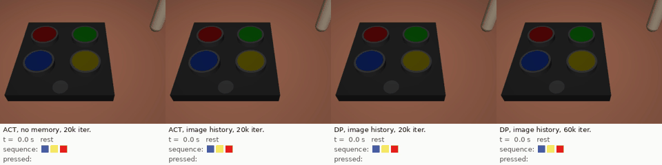
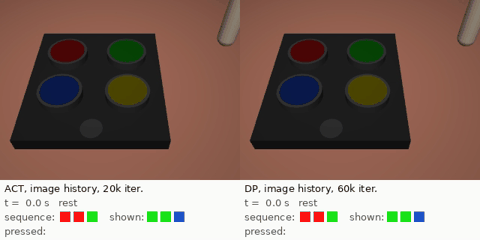

# RoboSimon: memory in visuomotor imitation policies

Do compact imitation policies (ACT, Diffusion Policy) use a history of images when a task requires memory? A simulated Simon game in MuJoCo: a sequence of coloured buttons is shown, hidden, and must be reproduced after a 2 s delay.



*Same test episode. From left to right: ACT without memory (never starts), ACT with image history (success), Diffusion Policy with image history after 20k iterations (memory error), the same after 60k iterations (success).*

## Results

- **ACT with an image history solves the task**: 100 % success for sequences of 2, 3 and 4 buttons; a memoryless policy stays at chance.
- **Diffusion Policy needs much longer training**: 78 / 46 / 34 % at the protocol budget (20k iterations), 99.7 % at 60k iterations, confirmed on fresh seeds.
- **Copycat behaviour is transient**: under-trained DP keeps repeating its previous motion, more so when it sees its past state; it disappears with longer training. ACT never shows it.



*Counterfactual test: the presentation is replaced by another sequence ("shown"). Both policies press the button they were shown, so they act on their memory.*

More rollouts in [`videos/`](videos): four-button sequences, policies that also see their past positions (where under-trained DP repeats a button), oracles and the scripted expert. Full study, statistics and pre-registered hypotheses: [report/main.pdf](report/main.pdf).

## Run

```sh
python test_simon.py                       # environment tests
python donnees.py 1 3                      # 500 demonstrations for L = 3 + frozen ResNet-18 embeddings
python entrainement.py E1:ACT:M1:3:0       # train, select on validation, evaluate on test
python diagnostics.py E1_ACT_M1_L3_s0      # inertia index, probes, counterfactual test
python analyse.py                          # figures and LaTeX tables of the report
```

Python 3.12, PyTorch, MuJoCo, zarr. Experiments ran on RTX 5070 GPUs.
